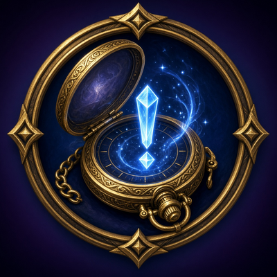

<p align="center"></p>

# RemindMeWhen

Shows on-screen reminders when conditions you set are met, such as a missing buff, poison, pet or ammo.

## Features

- **Conditions:** choose when a reminder shows, based on things like buffs, weapon enchants, cooldowns, items, combat, talents, zone, your target, your group or your pet.
- **Triggers:** show a reminder while its conditions are true, or for a few seconds after something happens, like a ready check.
- **Display:** show reminders as icons or bars, with optional text, timers and glow.
- **Groups:** groups hold reminders and other groups, and their settings apply to everything inside. Dynamic groups arrange their contents in a row or grid. Static groups let you place each one yourself.
- **Click actions:** click a reminder to cast a spell, use an item, apply a weapon poison or stone, or summon a mount.
- **Sounds and alerts:** play a sound or show a message when a reminder appears or a buff is about to run out.
- **Load rules:** load a reminder only for certain classes, levels or characters.
- **Snooze:** right-click a reminder to hide it for a while.
- **Import and export:** share reminders and groups as text.
- **Presets:** ready-made reminders for common needs like poisons, pets, food and repairs.

## Install

Install from CurseForge, or extract the `RemindMeWhen` folder from a release zip into `World of Warcraft/<version>/Interface/AddOns/`.

## Commands

| Command | Action |
|---|---|
| `/rmw` | Open the editor |
| `/rmw lock`, `/rmw unlock` | Lock the display, or start move mode to drag reminders and groups. You can also click Move in the editor. |
| `/rmw test` | Show all enabled reminders for a few seconds |
| `/rmw reset` | Move top-level reminders and groups back to the middle of the screen |
| `/rmw unsnooze` | Show all snoozed reminders again |
| `/rmw import`, `/rmw export` | Import or export reminders as text |
| `/rmw debug` | Print map and instance IDs, talent points and weapon enchant IDs |
| `/rmw spell <name or ID>` | Show which spell a name or ID matches |

## Development

The tests run the addon outside the game with stubbed WoW APIs.

```
pip install lupa
python tests/run.py
```

Pushing a tag that starts with `v` runs the tests and builds a release with the [BigWigs packager](https://github.com/BigWigsMods/packager). The release is uploaded to CurseForge when the `CF_API_KEY` secret is set.

## License

[GPL-3.0](LICENSE)
